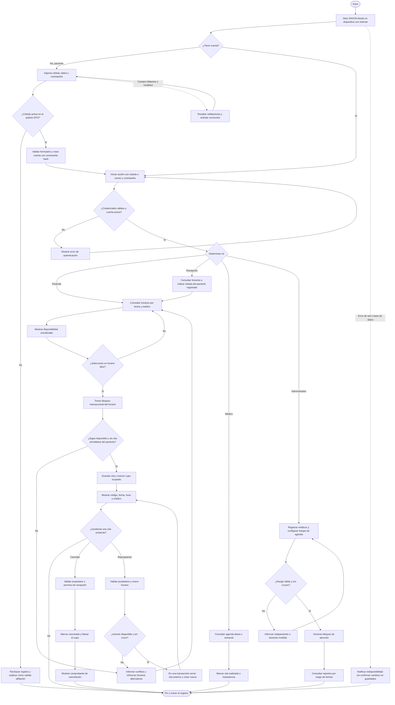

# Flujo del Sistema de Agendamiento Virtual de Citas de Medicina General

El flujo está alineado con los RF-01 a RF-08, las reglas RN-01 a RN-03 y las excepciones de la ficha SAVCM versión 1.0. Las rutas por rol representan las funciones del alcance.

## Correspondencia con la ficha

| Elemento | Implementación |
| --- | --- |
| RF-01, RF-02, RN-03 | Registro solo con cédula activa en el padrón, autenticación y autorización por rol. |
| RF-03 | Consulta de horarios libres por fecha y médico. |
| RF-04, RN-01, RN-02 | Reserva transaccional con bloqueo e índices únicos parciales de PostgreSQL. |
| RF-05, RF-06 | Reprogramación, cancelación y liberación del cupo anterior. |
| RF-07 | Creación de médicos y franjas por administrador. |
| RF-08 | Reportes de ocupación, cancelaciones, reprogramaciones e inasistencia. |
| Situaciones no ideales | Validaciones del formulario, conflicto de horario y errores de servicio. |
