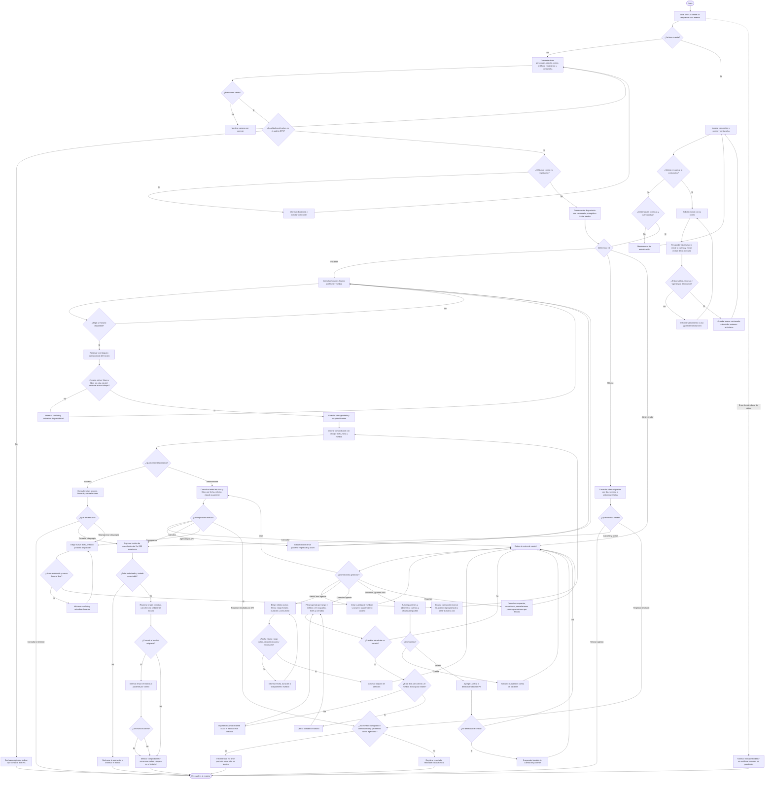

# Flujo del Sistema de Agendamiento Virtual de Citas de Medicina General

El diagrama resume los flujos implementados en SAVCM: registro y acceso, recuperación de contraseña, reserva y gestión de citas, operación médica y administración. Los permisos distinguen los roles de paciente, médico y administrador; no existe un rol de recepción.

## Correspondencia con las funciones implementadas

| Área | Comportamiento reflejado |
| --- | --- |
| Registro y acceso | Registro de pacientes solo con cédula activa en el padrón EPS; acceso con cédula o correo; autorización por rol. |
| Recuperación de contraseña | Enlace de un solo uso, vence a los 30 minutos y tiene espera de 60 segundos entre solicitudes; al cambiar la contraseña se invalidan las sesiones anteriores. |
| Reserva | Consulta de disponibilidad futura y reserva transaccional; se comprueban el estado del horario y del médico, la ocupación y las citas simultáneas del paciente. |
| Cancelación | Paciente cancela sus citas agendadas; médico cancela citas agendadas o reprogramadas de su agenda; administrador cancela citas agendadas. Se guarda motivo y origen (`DOCTOR`, `PATIENT` o `STAFF`). La cancelación del médico avisa por correo y el motivo queda en el historial aunque falle el envío. |
| Reprogramación y resultado | Paciente o administrador reprograma una cita agendada en una transacción. Médico asignado o administrador registra realizada/inasistencia después de terminar el horario. |
| Operación médica | Consulta de citas asignadas por día, semana o próximos 30 días. |
| Administración | Alta y activación de médicos, creación de bloques sin solapamientos, consulta y apertura/cierre de horarios, administración de cuentas y padrón EPS, consulta de citas, agendamiento por API para pacientes activos y reportes. |
| Situaciones no ideales | Validaciones de formulario, conflictos de disponibilidad o permisos, enlaces de recuperación inválidos y errores de servicio. |
